# RS Killhouse (`mp_rs_killhouse`)

A Call of Duty 4 multiplayer map, free to download and play on any CoD4 / CoD4X server.

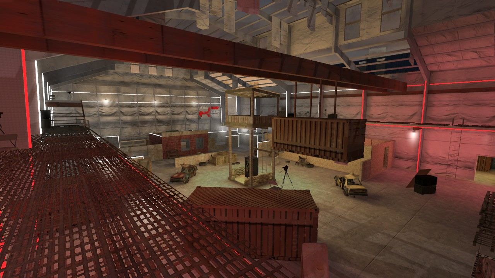

Infinity Ward's Killhouse, kept 1:1 and about 5% longer: each spawn side and each half of the maze sits 64 units
further out, so the middle around the tower opens up. It's a night map with RS neon: red on the attackers' half,
white on the defenders'.

- Instructors' galleries over the decks, with stairs and ladders up to them
- Bounces between the decks, the spawn roofs and the hanging container
- Two playable alleys outside, between the neighbouring hangars (grass strips you can't reach in the original),
  with side doors from the hangar, a studio backlot on the west and a storage row on the east
- A vending machine under the tower that gives Sleight of Hand, but everyone nearby hears you take it
- A top-down minimap, a loading screen, reflection probes and a light grid like IW's own maps
- Runs faster than stock Killhouse: in the same views, an average of 561 fps against stock's 416 on the test PC

## Original vs RS Killhouse

Each view is shot in both maps from the same spot, and the divider sweeps from the original to this one. Each half
of RS Killhouse sits 64 units further out, so its camera moves with it.

| | |
|---|---|
| 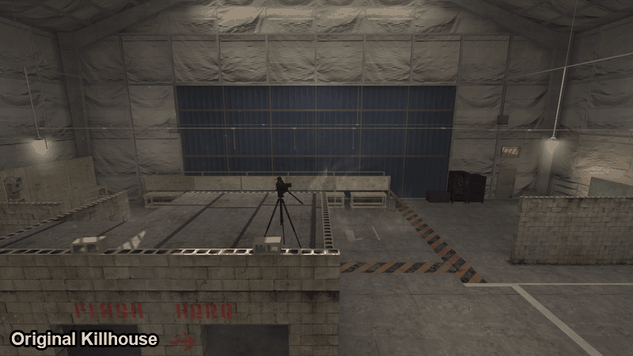 | 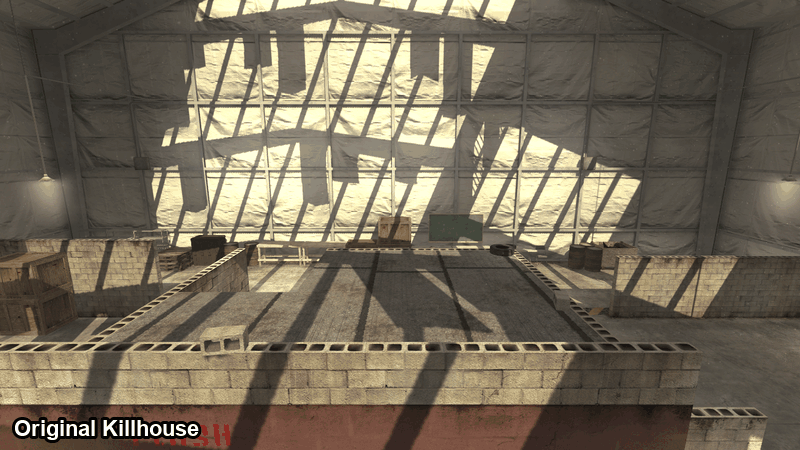 |
| 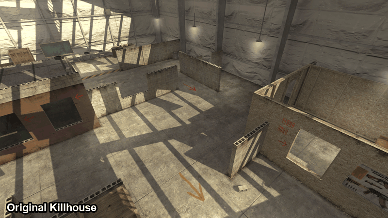 | 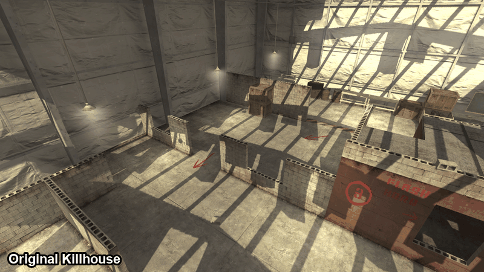 |
| 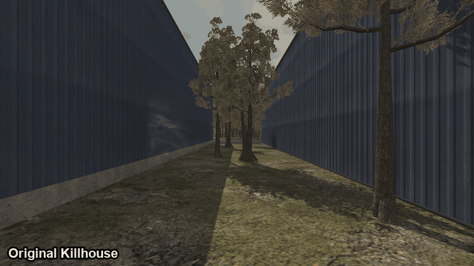 | 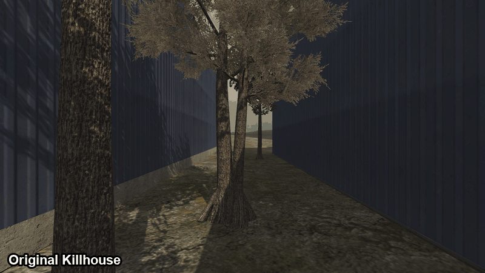 |

## Screenshots

| | |
|---|---|
| 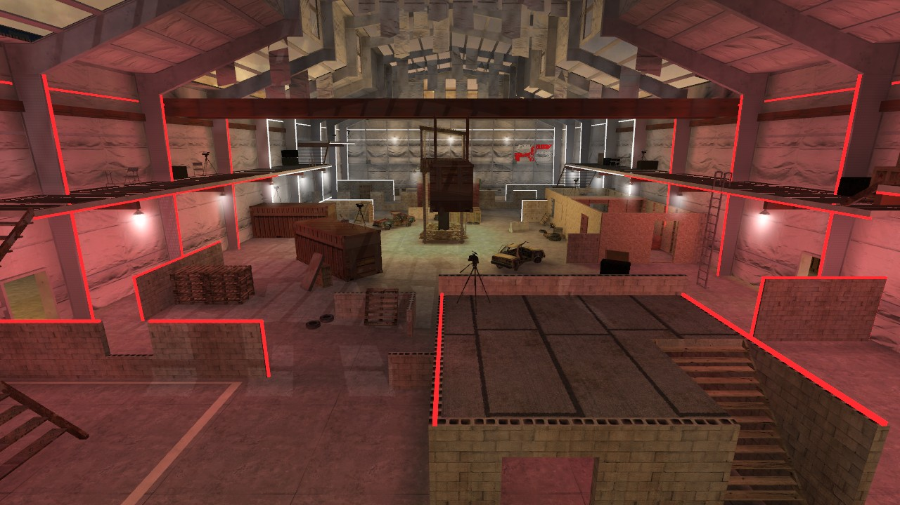 | 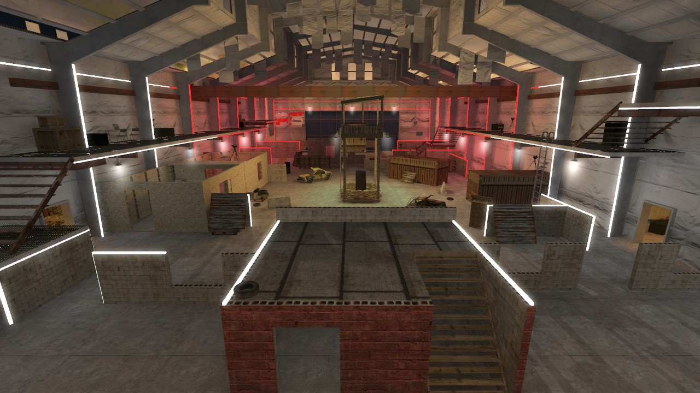 |
| 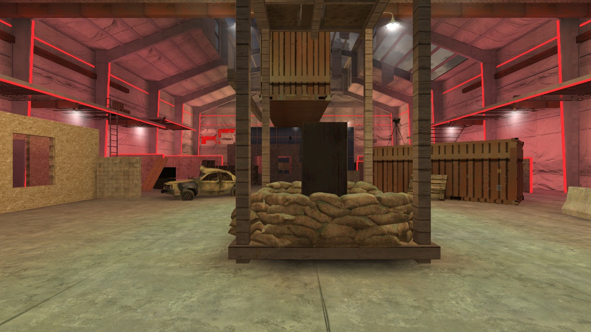 | 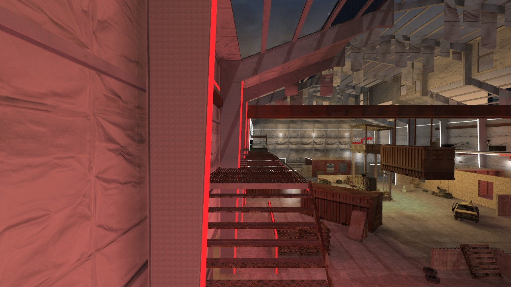 |
| 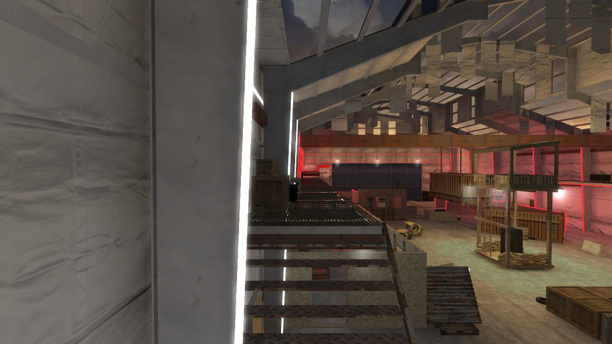 | 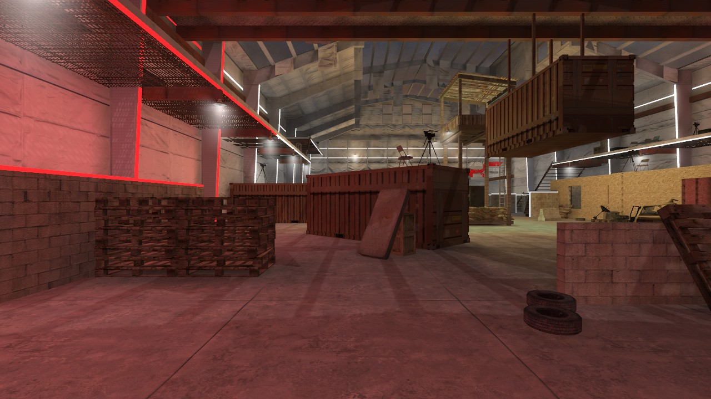 |
| 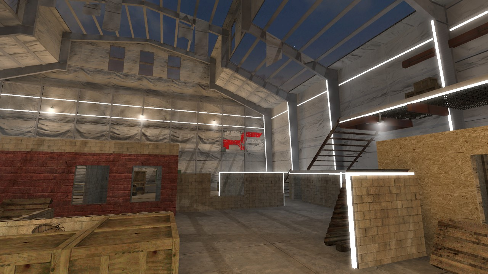 | 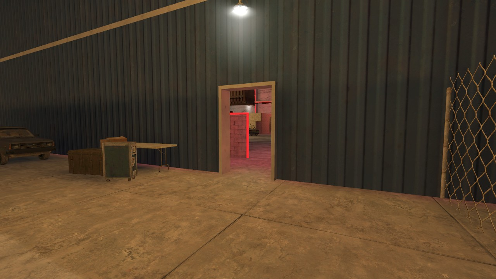 |
| 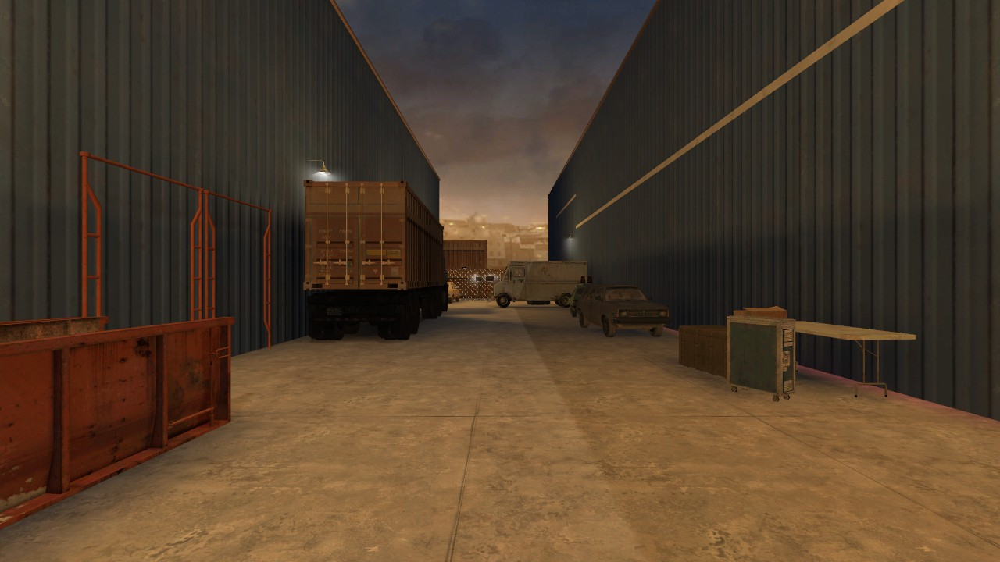 | 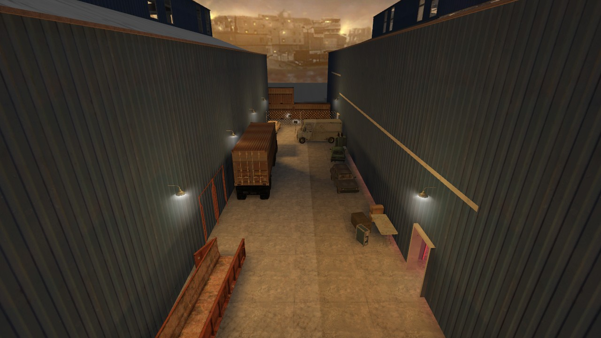 |
| 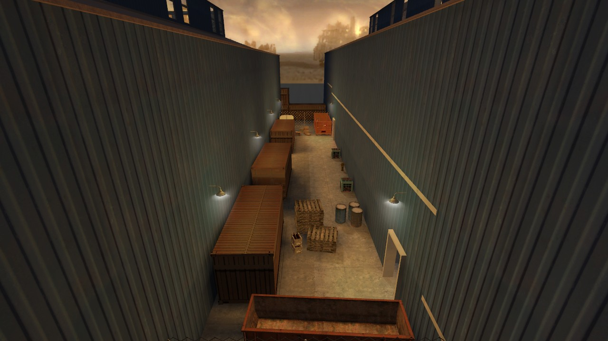 | 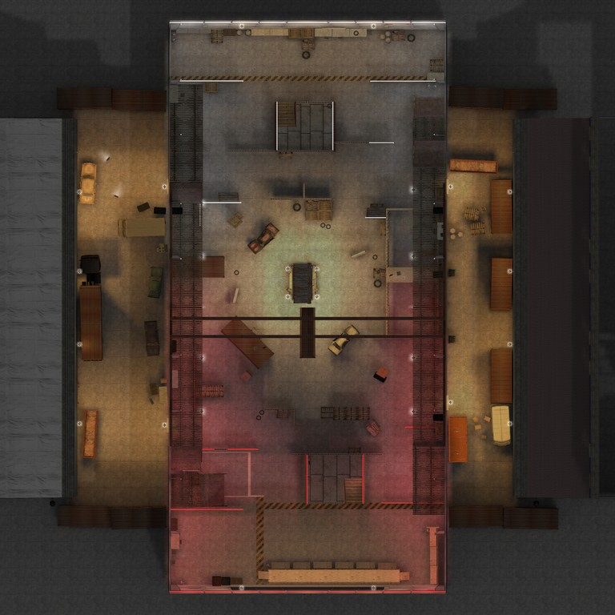 |

## Download and install

Either way works:

- **The three files:** open [`usermaps/mp_rs_killhouse`](usermaps/mp_rs_killhouse), click each file, then the
  download button on its page.
- **Everything at once:** GitHub's green **Code** button at the top of this page → **Download ZIP**. GitHub makes
  that zip of this whole page; inside it, the map is in the `usermaps` folder.

Put the map in your Call of Duty 4 folder, so you end up with:

```
<CoD4 folder>/usermaps/mp_rs_killhouse/
    mp_rs_killhouse.ff
    mp_rs_killhouse_load.ff
    mp_rs_killhouse.iwd
```

**Servers:** put the same folder in the server's game folder, then add the map to the rotation, for example:

```
set sv_mapRotation "gametype sd map mp_rs_killhouse"
```

Players without the map download it from the server if the server allows downloads.

## Gametypes

Free-for-all (`dm`), Team Deathmatch (`war`), Search & Destroy (`sd`), and Search & Rescue (`snr`, from the RS mod).

## Credits

- **mp_killhouse:** Infinity Ward (Call of Duty 4: Modern Warfare). The layout, buildings and objects are theirs.
- **IW3xo** by xoxor4d: used to export mp_killhouse to a `.map` to build from.
- Built with the Call of Duty 4 Mod Tools from Infinity Ward's own assets.
- Made by wasd.
