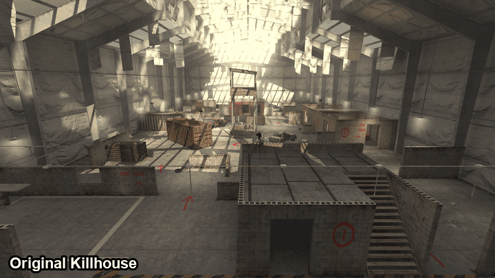
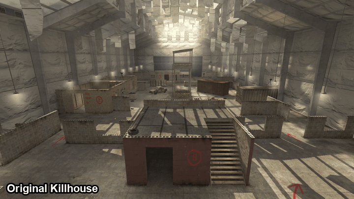
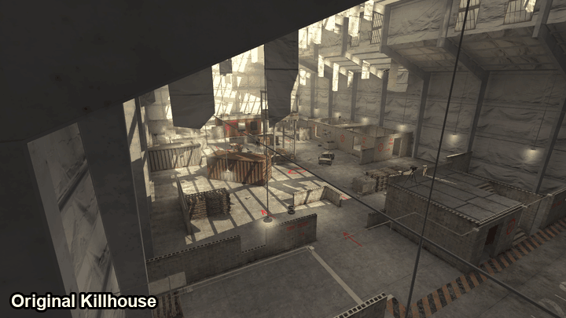
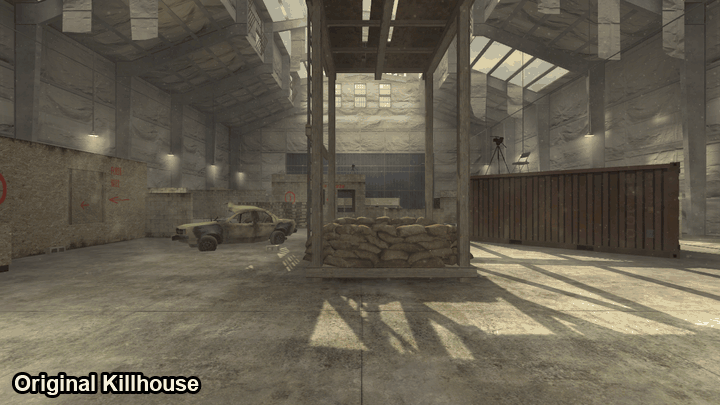

# RS Killhouse (`mp_rs_killhouse`)

A Call of Duty 4 multiplayer map, made for the RS server and playable on any CoD4 / CoD4X server.


Infinity Ward's Killhouse, kept 1:1 and about 5% longer: each spawn side and each half of the maze sits 64 units
further out, so the middle around the tower opens up. It's a night map with RS neon: red on the attackers' half,
white on the defenders'.

- Instructors' galleries over the decks, with stairs and ladders up to them
- Bounces between the decks, the spawn roofs and the hanging container
- Two alleys outside, between the neighbouring hangars
- A vending machine under the tower that gives Sleight of Hand, but everyone nearby hears you take it
- A top-down minimap, a loading screen, reflection probes and a light grid like IW's own maps
- Runs faster than stock Killhouse: in the same views, an average of 561 fps against stock's 416 on the test PC

## Original vs RS Killhouse

Each view is shot from the same camera in both maps; the divider sweeps from the original to this one.

| | |
|---|---|
|  |  |
|  |  |

## Screenshots

| | |
|---|---|
|  |  |
|  |  |
|  |  |
|  |  |

## Download and install

Click **Code → Download ZIP** at the top of this page, or download the three files in
[`usermaps/mp_rs_killhouse`](usermaps/mp_rs_killhouse) one by one.

Put them in your Call of Duty 4 folder, so you end up with:

```
<CoD4 folder>/usermaps/mp_rs_killhouse/
    mp_rs_killhouse.ff
    mp_rs_killhouse_load.ff
    mp_rs_killhouse.iwd
```

**Servers:** put the same folder in the server's game folder, then add the map to the rotation, for example:

```
set sv_mapRotation "gametype sd map mp_rs_killhouse"
```

Players without the map download it from the server if the server allows downloads.

## Gametypes

Free-for-all (`dm`), Team Deathmatch (`war`), Search & Destroy (`sd`), and Search & Rescue (`snr`, from the RS mod).

## Credits

- **mp_killhouse:** Infinity Ward (Call of Duty 4: Modern Warfare). The layout, buildings and objects are theirs.
- **IW3xo** by xoxor4d: used to export mp_killhouse to a `.map` to build from.
- Built with the Call of Duty 4 Mod Tools from Infinity Ward's own assets.
- Made by wasd for the RS server.
